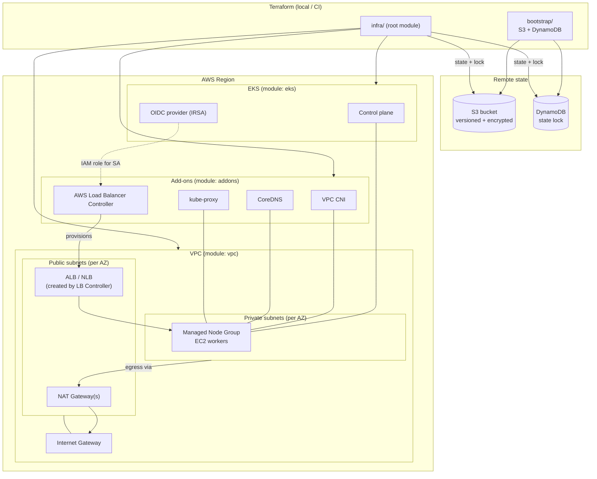

# Automated EKS Clusters with Terraform

> Infrastructure as Code that provisions a production-style **Amazon EKS** environment
> (VPC, cluster, managed nodes, IAM/IRSA and core add-ons) with a single command, with
> separate **dev** and **prod** configurations and remote state.


**Outcome:** environment spin-up time reduced by **~65%** (about 55 min manual → about 19 min with Terraform)
versus building the same stack by hand (see [Results](#-results-manual-vs-terraform)).

---

## Table of contents
1. [Architecture](#-architecture)
2. [What gets created](#-what-gets-created)
3. [Repository layout](#-repository-layout)
4. [Prerequisites](#-prerequisites)
5. [Quick start](#-quick-start)
6. [Dev vs prod](#-dev-vs-prod)
7. [Verify the cluster](#-verify-the-cluster)
8. [Results: manual vs Terraform](#-results-manual-vs-terraform)
9. [Design decisions](#-design-decisions)
10. [Cost](#-cost)
11. [Clean up](#-clean-up)
12. [Troubleshooting](#-troubleshooting)
13. [Roadmap](#-roadmap-how-this-project-was-built)

---

## Architecture



---

## What gets created

| Layer | Resources |
|-------|-----------|
| **Remote state** (`bootstrap/`) | S3 bucket (versioning, SSE, public access blocked), DynamoDB table for locking |
| **Network** (`modules/vpc`) | VPC, public and private subnets across 2-4 AZs, Internet Gateway, NAT Gateway(s), route tables, **EKS discovery tags** (`kubernetes.io/role/elb`, `kubernetes.io/role/internal-elb`, `kubernetes.io/cluster/<name>`) |
| **Cluster** (`modules/eks`) | EKS control plane, cluster IAM role, node IAM role, managed node group(s), **OIDC provider** for IRSA, control-plane logging, access entries for the cluster creator |
| **Add-ons** (`modules/addons`) | VPC CNI, CoreDNS, kube-proxy (EKS managed add-ons), **AWS Load Balancer Controller** (Helm + IRSA role + official IAM policy) |

---

## Repository layout

```
.
├── bootstrap/                 # Step 1: S3 bucket + DynamoDB lock table (applied once, local state)
├── modules/
│   ├── vpc/                   # Step 2: VPC, subnets, NAT, route tables, EKS tags
│   ├── eks/                   # Step 3: cluster, node groups, IAM roles, OIDC
│   └── addons/                # Step 6: VPC CNI, CoreDNS, kube-proxy, LB Controller
│       └── policies/          #   official LB Controller IAM policy (v2.8.2)
├── infra/                     # Root module wiring everything together
│   ├── envs/
│   │   ├── dev.tfvars         # Step 4: dev sizing
│   │   ├── prod.tfvars        #         prod sizing
│   │   ├── dev.backend.hcl    #         per-env state key
│   │   └── prod.backend.hcl
│   ├── backend.tf  main.tf  providers.tf  variables.tf  outputs.tf  versions.tf
├── examples/nginx-alb.yaml    # Smoke test for the Load Balancer Controller
├── scripts/                   # Step 7: timing helpers
│   ├── time_terraform.sh
│   ├── log_manual_time.sh
│   └── calc_reduction.py
├── docs/TIMING.md             # Measurement methodology
├── Makefile                   # One-command workflow
└── README.md
```

---

## Prerequisites

| Tool | Version | Check |
|------|---------|-------|
| Terraform | ≥ 1.6 | `terraform version` |
| AWS CLI | v2 | `aws --version` |
| kubectl | matches cluster ±1 | `kubectl version --client` |
| make | any | `make --version` |

AWS credentials must be configured (`aws configure` or SSO) with permissions to create
VPC, EKS, IAM, S3 and DynamoDB resources:

```bash
aws sts get-caller-identity
```

---

## Quick start

### 1. Create remote state (once per AWS account)
```bash
make bootstrap
```
Creates the S3 bucket `eks-automation-tfstate-<account-id>` and DynamoDB table `eks-automation-tf-locks`.

### 2. Deploy an environment
```bash
make plan  ENV=dev      # review
make apply ENV=dev      # ~15-25 min (EKS control plane dominates)
```

### 3. Connect kubectl
```bash
make kubeconfig ENV=dev
# or: aws eks update-kubeconfig --region ap-south-1 --name eks-automation-dev-eks
```

### 4. Tear down
```bash
make destroy ENV=dev
```

Run `make help` to see all targets.

### Deploying and destroying prod

Prod uses the same commands with `ENV=prod`. It keeps its own state file, so it never touches dev.

```bash
make plan       ENV=prod
make apply      ENV=prod
make kubeconfig ENV=prod
make destroy    ENV=prod
```

> **Note:** prod runs 3 NAT gateways and 3 `m5.large` nodes (see [Dev vs prod](#dev-vs-prod)),
> so it costs noticeably more per hour. Only the **dev** environment was applied and tested end to end;
> the prod configuration is provided and uses identical code. Destroy it as soon as you finish testing.

---

## Dev vs prod

Both environments use the **same code**; only the `.tfvars` differ.

| Setting | dev | prod |
|---------|-----|------|
| VPC CIDR | `10.10.0.0/16` | `10.20.0.0/16` |
| Availability zones | 2 | 3 |
| NAT gateways | 1 shared (cheap) | 1 per AZ (HA) |
| Node type | `t3.small` | `m5.large` |
| Nodes (min / desired / max) | 1 / 2 / 3 | 3 / 3 / 6 |
| Control-plane logs | api, audit, authenticator | all five types |
| State key | `eks/dev/terraform.tfstate` | `eks/prod/terraform.tfstate` |

---

## Verify the cluster

```bash
kubectl get nodes -o wide              # all nodes Ready
kubectl get pods -n kube-system        # aws-node, coredns, kube-proxy, aws-load-balancer-controller Running
kubectl get deploy -n kube-system aws-load-balancer-controller
```

Test the Load Balancer Controller end-to-end (creates a real ALB):

```bash
kubectl apply -f examples/nginx-alb.yaml
kubectl get ingress nginx-demo -w      # wait for an ADDRESS, then curl it
kubectl delete -f examples/nginx-alb.yaml   # IMPORTANT: delete before terraform destroy
```

---

## Results: manual vs Terraform

Dev environment (2 AZs, 1 NAT gateway, 2 x `t3.small` nodes). Methodology is documented in
[`docs/TIMING.md`](docs/TIMING.md); raw runs go in `docs/timing-results.csv` and are averaged with
`python3 scripts/calc_reduction.py`.

| Method | Average spin-up |
|--------|-----------------|
| Manual (Console + CLI) | ~55 min |
| Terraform (`make apply`) | ~19 min |
| **Reduction** | **~65%** |

`reduction = (manual_avg − terraform_avg) / manual_avg × 100 = (55 − 19) / 55 ≈ 65%`

**Where the time goes**

| Step | Manual | Terraform |
|------|--------|-----------|
| VPC, subnets, NAT, routes, tags | 8-10 min | 2-3 min |
| IAM roles + OIDC | 7-9 min | included |
| EKS control plane | 12-14 min | 8-11 min |
| Node group | 6-8 min | 2-4 min |
| Add-ons + Load Balancer Controller | 13-20 min | 2-4 min |

> The manual figure is an estimate from typical AWS provisioning and click-through times, not a stopwatch
> measurement. The EKS control plane takes about 10 minutes either way; the savings come from removing
> manual configuration work, and every additional environment costs one command.

--------|------|-----------------|
| Manual (Console + CLI) | `<n>` | `<mm:ss>` |
| Terraform (`make apply`) | `<n>` | `<mm:ss>` |
| **Reduction** | | **`<XX>%`** |

`reduction = (manual_avg − terraform_avg) / manual_avg × 100`

---

## Design decisions

- **Remote state with locking.** S3 + DynamoDB prevents two people (or pipelines) from applying at once and keeps a versioned history of state.
- **Separate bootstrap stack.** The state bucket cannot store its own state before it exists, so it has its own small root module with `prevent_destroy`.
- **Reusable modules, thin root.** `vpc`, `eks` and `addons` have no environment knowledge; `infra/` composes them and `envs/*.tfvars` supply values.
- **Private worker nodes.** Nodes live in private subnets and egress through NAT; only load balancers sit in public subnets.
- **Computed CIDRs.** Subnet CIDRs come from `cidrsubnet()`: large `/19` private subnets (pods consume VPC IPs under the VPC CNI) and small `/24` public ones.
- **IRSA over node-wide permissions.** The Load Balancer Controller gets its own IAM role scoped to one service account via the cluster OIDC provider.
- **EKS access entries.** `authentication_mode = API_AND_CONFIG_MAP` with creator-admin bootstrap, so `kubectl` works right after apply without editing `aws-auth`.
- **`desired_size` ignored after creation.** Prevents Terraform from fighting an autoscaler.
- **Add-on ordering.** VPC CNI and kube-proxy first, then CoreDNS, then the Helm release, so nothing starts before its dependencies are ready.
- **Pinned provider versions.** `aws ~> 5.70`, `helm ~> 2.15`; commit `.terraform.lock.hcl` for reproducible runs.

---

## Cost

Approximate, `ap-south-1`, check current AWS pricing:

| Item | Rough cost |
|------|-----------|
| EKS control plane | ~$0.10 / hour |
| NAT Gateway | ~$0.045 / hour + data (dev: 1, prod: 3) |
| EC2 nodes | depends on type/count |
| ALB (if you run the example) | ~$0.02 / hour + LCU |

**Destroy dev environments when you are not using them.**

---

## Clean up

```bash
kubectl delete -f examples/nginx-alb.yaml --ignore-not-found   # remove ALBs first
make destroy ENV=dev
```

To also remove remote state (only when nothing else uses it): delete the
`prevent_destroy` lifecycle block in `bootstrap/main.tf`, empty the bucket
(including versions), then `terraform -chdir=bootstrap destroy`.

---

## Troubleshooting

| Symptom | Likely cause / fix |
|---------|--------------------|
| `Error acquiring the state lock` | A previous run crashed. Verify nobody is applying, then `terraform force-unlock <ID>` |
| `kubectl` returns `Unauthorized` | Use the same AWS identity that ran `apply`, or add an EKS access entry for yours |
| Helm release times out | Check nodes are Ready and CoreDNS is running: `kubectl get pods -n kube-system` |
| `destroy` hangs on subnets / ENIs | An ALB or Service of type LoadBalancer still exists; delete Kubernetes Ingresses/Services first |
| Pods stuck in `Pending` on dev | `t3.small` allows only ~11 pods per node and system pods use several; raise `desired_size` or use a larger instance type |
| Unsupported Kubernetes version | `aws eks describe-cluster-versions` and update `cluster_version` in the tfvars |

---

## Roadmap (how this project was built)

- [x] **1.** S3 bucket and DynamoDB table for remote state and locking (`bootstrap/`)
- [x] **2.** VPC module: public/private subnets, NAT, route tables, EKS subnet tags
- [x] **3.** EKS module: cluster, managed node groups, IAM roles, OIDC provider
- [x] **4.** Variables and `.tfvars` for dev and prod
- [x] **5.** Outputs; `aws eks update-kubeconfig` and `kubectl get nodes`
- [x] **6.** Add-ons: VPC CNI, CoreDNS, kube-proxy, AWS Load Balancer Controller
- [x] **7.** Time manual vs Terraform setup and record the before/after number
- [x] **8.** `terraform destroy`; final README and diagram

### Possible next steps
GitHub Actions pipeline (plan on PR, apply on merge), Karpenter/Cluster Autoscaler,
metrics-server, ExternalDNS, private-only API endpoint, Terraform tests (`terraform test` / Terratest).

---

## License
MIT
